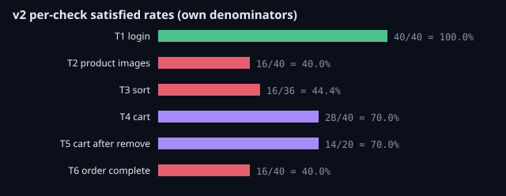
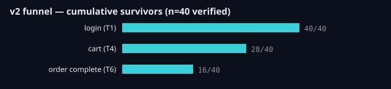
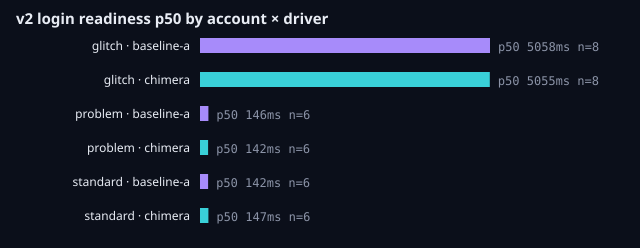
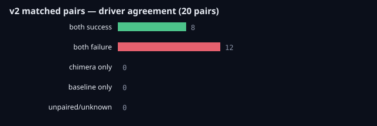

# Campaign V2 — Behavioural Stress Testing: Consolidated Report

Real Chromium executions on the SauceDemo practice store, comparing the
Chimera agent against the Baseline A replay driver under behaviourally
challenging accounts. All figures below come from persisted run evidence;
every trial was independently re-verified from its raw stages file.

## Headline finding

**Chimera and Baseline A behaved identically on all 40 stress trials.**
Verdict agreement is 20/20 matched pairs, every per-check rate delta is
0.0, and report-vs-verdict accuracy is 40/40. The campaign found no
driver differences: site defects dominate, and neither waiting, retries,
nor verification policy changes any outcome. The measurable driver
difference is efficiency, not correctness — Chimera's longer waits cost
time (duration p50 6180 ms vs 1499 ms) for identical results.

## Campaign identity

| Item | Value |
|---|---|
| Campaign | SauceDemo stress v2 — `2a9a969d-bca6-42e4-954c-62f3a1cacb93` |
| Window (UTC) | 2026-10-30 16:45:21 → 16:51:06 (~5m45s wall) |
| Design | 20 conditions × 2 drivers × 1 rep = **40 trials**, sequential, 3 s pacing |
| Conditions | account {standard, glitch, problem} × sort {az, za, lohi} × remove {remove, keep}, plus glitch × sort=none × {remove, keep} |
| Cart | backpack + bike light (2 items); removal drops the bike light |
| Pilot | SauceDemo stress v2 pilot — `2aa70c11-7d95-4555-b749-d87f1c2be224`, 6 trials, completed 16:32:55 → 16:33:44, no errors |
| V1 (immutable) | SauceDemo balanced v1 — `cff73ff8-88d0-4143-a21e-e013f34f194a`, still 80/80 completed; its analytics recompute byte-identically |

## Results (40/40 verified, 16 success / 24 failure, 0 errors)

Per-check satisfied rates (each check's own denominator):

| Check | Stage | Satisfied | n | Rate |
|---|---|---|---|---|
| T1 | login (readiness timed) | 40 | 40 | 100% |
| T2 | product images | 16 | 40 | 40% |
| T3 | sort (only when sorting) | 16 | 36 | 44% |
| T4 | cart holds added items | 28 | 40 | 70% |
| T5 | cart holds remainder (only when removing) | 14 | 20 | 70% |
| T6 | order complete | 16 | 40 | 40% |

Funnel (cumulative): login 40 → cart 28 → order complete 16.

By account × driver (success = all applicable T-checks satisfied):

| Account | Chimera | Baseline A |
|---|---|---|
| Standard (control) | 6/6 | 6/6 |
| Slow login (glitch) | 2/8 | 2/8 |
| Problem user | 0/6 | 0/6 |

Failure stages: flow completed 16, product images 12 (all problem-user),
sort 12 (all glitch-with-sort: the sort step times out for both drivers
before inventory is captured).

Login readiness (click-to-readiness from login stage states, 0 missing):

| Account | Chimera p50 | Baseline A p50 |
|---|---|---|
| Slow login | 5055 ms (n=8) | 5058 ms (n=8) |
| Problem user | 142 ms (n=6) | 146 ms (n=6) |
| Standard | 147 ms (n=6) | 142 ms (n=6) |

Matched pairs: 8 both-success, 12 both-failure, 0 split either way —
agreement 1.0 over 20 adjudicated pairs, 0 unpaired, 0 unknown.

Flow durations: p50 6175 ms, p95 10845 ms, n=40, 0 missing.

## What the site did (quoted live evidence)

- **Problem user — 3 confirmed site defects.** All 6 products show one
  placeholder (`/assets/sl-404-Cq1a9k9X.jpg`); sorting never reorders
  (za/lohi stay A–Z); checkout rejects complete valid info with
  `Error: Last Name is required`. Cart add/remove/identity all work
  (T4/T5 pass). T6 fails by site rejection, quoted in every trial.
- **Slow-login user — 2 behaviours.** Login readiness is ~5.06 s with
  <10 ms spread across 16 trials and both drivers (T1 always passes).
  The sort control then times out for both drivers (Chimera's 5 s wait
  and replay's 0.1 s attempt fail alike), killing glitch-with-sort
  trials at that step. With sorting skipped (glitch × none), the full
  downstream flow — add, remove, cart, checkout — succeeds for both
  drivers (4/4), isolating the defect to the sort interaction.
- **Standard user — clean control.** 12/12 full passes, ~145 ms logins.

## Pilot-driven design changes

1. The pilot (6 trials) showed glitch-with-sort blocks both drivers at
   the select step, so 2 glitch × sort=none conditions were added
   (36 → 40 trials) to isolate downstream behaviour. The main campaign
   confirmed the diagnosis (glitch+none 4/4 pass).
2. Failure-stage attribution was refined: a site-rejected attempt no
   longer overrides an earlier genuine check failure, and select-step
   timeouts attribute
...[truncated 3964 chars]