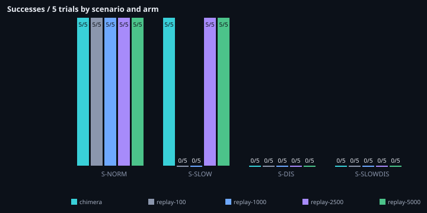
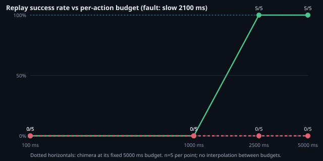
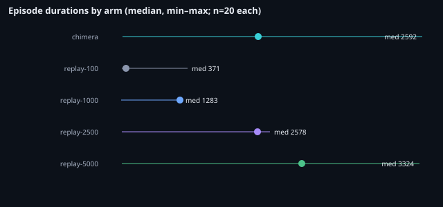

# Matched-budget experiment v1 — report

**Question:** does Chimera outperform Baseline A when both receive an
equivalent execution budget?

**Answer in one paragraph:** no difference was observed. Across 20
matched pairs (4 scenarios × 5 trials), Chimera at its fixed 5000 ms
per-action budget and replay at a matched 5000 ms budget agreed on
all 20 outcomes (10 both-succeed, 10 both-fail, 0 disagreements).
Varying replay's budget from 100 ms to 5000 ms moves S-SLOW from
0/5 to 5/5 with the step falling between 1000 ms and 2500 ms —
the fault delay is 2100 ms — while S-SLOWDIS stays 0/5 at every
budget. The October 28 S-SLOW gap is therefore explained by budget,
not capability, within the tested conditions. n=5 per cell; no
generality claims follow.

## 1. Methodology

Design, hypotheses, and confounds: `DESIGN.md` (read it first).
Five arms × one manifest (`manifest-mb-v1.json`, 4 cells × 5
measured trials + 1 warm-up): chimera (fixed 5000 ms/action),
replay at 100 / 1000 / 2500 / 5000 ms per-action timeouts.
105 executions, 100 measured. Outcomes judged symmetrically by
the stock independent verifier (P1–P3); pairing by cell +
measured-trial index (deterministic runner order). A 15-execution
pilot (S-SLOW only) validated plumbing, the budget override, and
evidence capture before the main runs.

The only code change vs stock Chimera: an additive,
default-preserving `action_timeout_ms` override on Baseline A
(`benchmarks/baseline_a.py`, default still 100 ms), covered by 4
new unit tests. Runner, verifier, observer, agent, schemas, and
all October 28 artifacts are untouched.

## 2. Results

### 2.1 Outcomes by scenario and arm (k/n succeeded)

| Scenario | Chimera 5000 | Replay 100 | Replay 1000 | Replay 2500 | Replay 5000 |
|----------|--------------|------------|-------------|-------------|-------------|
| S-NORM | 5/5 | 5/5 | 5/5 | 5/5 | 5/5 |
| S-SLOW (2100 ms) | 5/5 | 0/5 | 0/5 | 5/5 | 5/5 |
| S-DIS | 0/5 | 0/5 | 0/5 | 0/5 | 0/5 |
| S-SLOWDIS (2100 ms) | 0/5 | 0/5 | 0/5 | 0/5 | 0/5 |

5/5 → 95% Wilson [56.6%, 100%]; 0/5 → [0.0%, 43.5%]. Every cell
matches its manifest expectation in the arms that can resolve it.

### 2.2 Primary comparison: chimera vs replay-5000 (20 pairs)

| | Replay-5000 succeed | Replay-5000 fail |
|---|---|---|
| **Chimera succeed** | 10 | 0 |
| **Chimera fail** | 0 | 10 |

Per scenario: S-NORM 5 both-succeed; S-SLOW 5 both-succeed;
S-DIS 5 both-fail; S-SLOWDIS 5 both-fail. Zero discordant pairs,
so the exact McNemar test is uninformative (p = 1.0 by
degeneracy, not by evidence of equivalence): the finding is the
observed 20/20 agreement itself, at n=5 per cell.

### 2.3 Replay budget response (H2)

S-SLOW: 0/5 at 100 ms, 0/5 at 1000 ms, 5/5 at 2500 ms, 5/5 at
5000 ms — a step between 1000 ms and 2500 ms, bracketing the
2100 ms fault delay as predicted. S-SLOWDIS: 0/5 at all four
budgets — waiting cannot resolve a disabled input, as predicted.

### 2.4 Timing, timeouts, retries, terminals

| Arm | Timeouts | Retries (all) | Terminals | False successes | Durations ms (min/p50/p95/max) |
|-----|----------|---------------|-----------|-----------------|--------------------------------|
| chimera | 10 | 0 | 10 failed / 10 succeeded | 0 | 310 / 2592 / 5335 / 5350 |
| replay-100 | 15 | 0 | 15 failed / 5 succeeded | 0 | 297 / 371 / 394 / 1413 |
| replay-1000 | 15 | 0 | 15 failed / 5 succeeded | 0 | 294 / 1283 / 1297 / 1298 |
| replay-2500 | 10 | 0 | 10 failed / 10 succeeded | 0 | 297 / 2578 / 2788 / 2790 |
| replay-5000 | 10 | 0 | 10 failed / 10 succeeded | 0 | 297 / 3324 / 5297 / 5302 |

Timeouts are Playwright action timeouts recorded in episode
errors (all failures in every arm). The retries metric is 0 on
all 100 measured episodes — including Chimera's failures, which
terminate after a single 5 s fill attempt (fill carries no
effect check, so the second attempt is refused as blind; the
"failed after 2 attempt(s)" message names the configured max,
not attempts spent). No false successes, no harness errors, no
cancellations in any arm.

### 2.5 Evidence completeness

100/100 measured episodes carry trace artifacts (chimera event
traces, replay driver reports + action logs) and `verified`
P1–P3 verifier status. All run files, per-arm configs, traces,
snapshots, and manifests are preserved under `runs/` (pilot:
15 executions; main: 105 executions).

## 3. Hypotheses assessed

- **H1 (budget explains the gap): supported descriptively.**
  Matched at 5000 ms, the drivers are indistinguishable on all
  20 pairs. The Oct-28 S-SLOW gap (75/75 vs 0/75) does not
  survive budget equalization.
- **H2 (step response): supported.** The S-SLOW step falls
  between 1000 ms and 2500 ms; S-SLOWDIS is flat 0/5.

## 4. Limitations and confounds

DESIGN.md assumptions 1–6 apply in full: same-machine
wall-clock timings; single input (I-PLAIN); single slow value
(2100 ms); no human audit of these runs (machine verifier
only); Chimera's success-path verification waits have no replay
equivalent (residual asymmetry, bounded: it can only make
Chimera slower, never more successful, since outcomes come from
the harness verifier); fixed trial order with one warm-up on
S-NORM only. n=5 per cell gives wide intervals
(5/5 → lower bound 56.6%).

## 5. Conclusions

1. Under matched per-action budgets, Chimera shows no outcome
   advantage over fixed replay on these four conditions —
   because, as the traces confirm, Chimera's effective behavior
   here *is* single-attempt wait-then-act: its retry path never
   fires for fill.
2. The scientifically interesting gap was never S-SLOW (pure
   budget) but the missing capability both drivers share:
   neither recovers, replans, or resolves a disabled input.
3. Any future claim of a Chimera advantage must first show a
   condition where its verification waits or attempt structure
   change an outcome — this experiment's conditions are not it.

No statistical significance is claimed (a degenerate p = 1.0
with zero discordant pairs carries no information either way),
no general reliability is implied, and the October 28 frozen
evaluation is unaffected: this experiment lives entirely in
`experiments/matched-budget-v1/` plus the additive,
default-preserving replay override.
